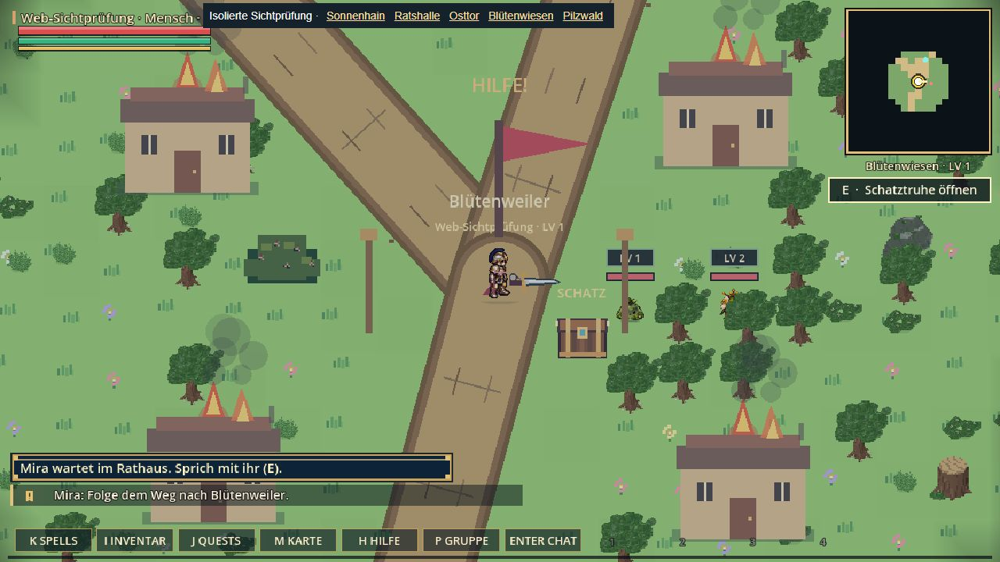
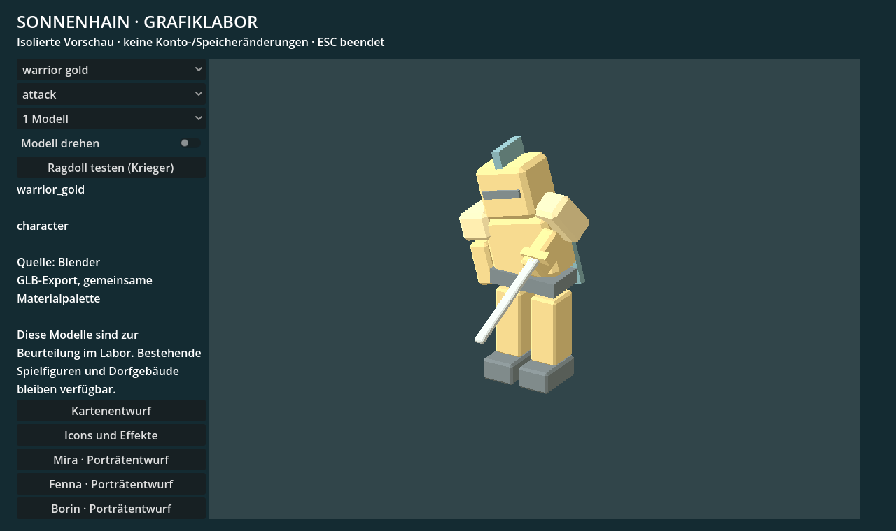
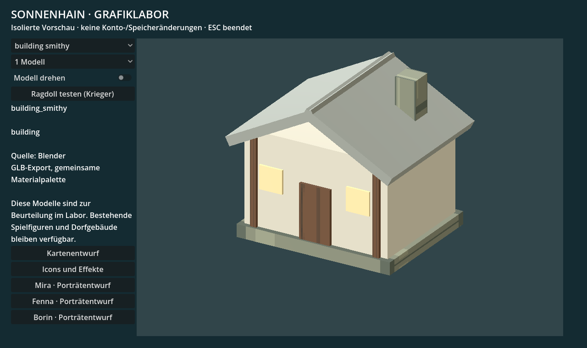
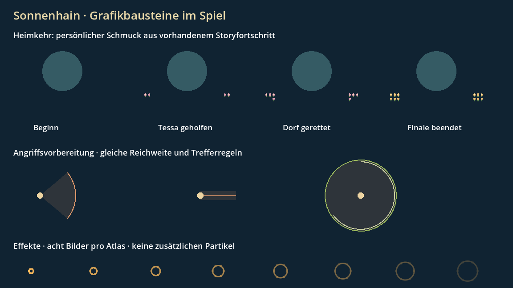

# Grafik- und Leistungspaket · Stand 16.10.2026

Das erste Paket ist lokal umgesetzt. Es verbessert den bestehenden Renderer,
die Minimap und die Lesbarkeit im Kampf. Neue Figuren, Gebäude und Porträts
stehen als bearbeitbare Prototypen im Grafiklabor; sie ersetzen noch nicht
flächendeckend die vorhandene Spielgrafik. Die gemeldeten Online-Lags sind
damit noch nicht als behoben nachgewiesen. Es erfolgte kein Live-Gang.

Prüfbarer Branch: `feature/quality-performance-20261016`,
[Entwurfs-PR #136](https://github.com/tryla27/RPG-Sonnenhain/pull/136).
Der aktuelle Hauptstand mit Server-Speicherfix ist integriert.

## Bereits im Spiel angebunden

- Landschaftsobjekte behalten feste Plätze auf Atlasseiten. Ruhende Seiten
  werden nur bei Änderungen neu gerendert. Animierte Objekte haben eigene
  kleinere Seiten. Ein begrenzter Rückwegcache vermeidet Neuerstellungen.
- Sichtbare Objekte werden höchstens alle 250 ms gesammelt; eine Randzone
  lädt vor. Geländedekoration und Minimapfarben verwenden begrenzte Caches.
  Erkundungsnebel und bewegliche Kartenmarker bleiben aktuell.
- Die vorhandene Prüfung auf leere 3D-Ausgabe berücksichtigt alle aktiven
  Seiten. Bei fehlender Ausgabe bleibt der bestehende 2D-Rückfall erhalten.
- Angriffsvorbereitungen zeigen Flächen gemäß der vorhandenen Reichweite.
  Schaden, Zeiten und Trefferregeln bleiben gleich. Der Wolf behält seine
  vereinbarte Sprungpose ohne zusätzliche Zielmarkierung.
- Vier kompakte Effektatlanten und ein Quest-Symbol sind eingebunden.
- Persönlicher Blütenschmuck am Dorfstein reagiert auf bestehende
  Storyzustände. Keine neuen Speicherfelder, Belohnungen oder Collider.
- F3 zeigt zusätzlich P95/P99-Bildzeiten.

## Die zehn Grafikvorhaben

| Vorhaben | Konkreter Stand | Noch erforderlich |
|---|---|---|
| Waffen | Schwert, Stab, Bogen in je drei Stufen als GLB und transparente Itembilder | Handpositionen und Ausrüstung im Spiel prüfen |
| Skelettanimation | Goldener Krieger, acht Knochen, neun Animationen; Physik-Ragdoll im Labor | Stil, Bewegungen und alle Blickrichtungen ausarbeiten; Spielanbindung |
| Effekte | Feuer, Eis, Gift und Treffer als achtteilige Atlanten im Kampffeedback | Lesbarkeit in dichtem Koopkampf prüfen |
| NPC-Porträts | Mira, Fenna, Borin mit ComfyUI erzeugt und als Krita-Projekte gerahmt | Identität und Stil mit bestehender NPC-Grafik abstimmen; Dialogeinbau |
| Weltkarte | Inkscape-SVG aus tatsächlichen Gebiets-/Wegdaten und PNG | Beschriftung und Karteninteraktion ausarbeiten |
| Gebäudebaukasten | Mauern, Ecke, Ende, Tore, Schmiede, Taverne und Rathaus | Modulare Anschlüsse, vorhandene Kollisionen und Platzierung im Piloten prüfen |
| Gegnerlesbarkeit | Vorwarnflächen im bestehenden Kampf eingebaut | Manueller Drei-Klassen-/Koopdurchgang |
| Gegenstandssymbole | Sechs HUD-Symbole und neun Waffenbilder exportiert | Weitere Symbole gezielt in vorhandene UI einbauen |
| Storyvarianten | Drei Steinrosenmodelle im Labor; persönlicher Dorfschmuck im Spiel | Steinrosenvarianten nach visueller Abnahme anbinden |
| Reproduzierbare Pipeline | Blender-, SVG-, Krita-, ComfyUI-Quellen, Metadaten und Prüfwerkzeuge vorhanden | CI-Prüfung des konkreten Pakets; Vergleich auf weiteren Geräten |

Feste Gegenstände allein sparen keine Renderarbeit. Entscheidend sind die
ausbleibenden Aktualisierungen ruhender Atlasseiten und die Wiederverwendung
der Objekte. Große neue Gebäude müssen innerhalb derselben Leistungsgrenzen
bleiben. Die vorhandenen Weltkollisionen bleiben maßgeblich.

## Messung und Grenzen

Native lokale Prüfrouten: Godot 4.7.2, RTX 3060, 1152 × 648,
Zoom 1, ohne Netzwerk und Gegner-KI; 240 Bilder pro Route, die ersten 30
nicht gewertet. Bewegung: 60 Bilder stehen, 90 hin, 90 zurück.
Ausgangsstand: lokaler Commit `57832b5`; Optimierung: `b9a6219`.

| Route | P95 vorher | P95 nachher | P99 vorher | P99 nachher |
|---|---:|---:|---:|---:|
| Wiese | 31,081 ms | 17,351 ms | 61,599 ms | 51,061 ms |
| Mauertor | 27,116 ms | 16,739 ms | 60,413 ms | 51,399 ms |
| Pilzwald | 32,276 ms | 16,708 ms | 62,345 ms | 52,479 ms |

Damit sank die P95-Bildzeit dieser lokalen Routen um etwa 38 bis 48 Prozent.
Der HUD-Zeichenabschnitt lag zuletzt bei rund 2,5 statt 13 ms.
Es gibt weiterhin einzelne langsame Bilder und hohe Kosten beim ersten
Modellaufbau. Die kurze Messung unter laufender Entwicklungsumgebung ist
keine Garantie für stabile 60 FPS, Browser, Smartphone oder Live-Koop.
Die letzte Messung enthielt drei Bilder über 50 ms je Route.
Die erste Modellsammlung kostete bis zu rund 193 ms; dieses Laden bleibt
ein Ansatzpunkt für weitere Arbeit. Die Atlasfarbpuffer belegten je nach
Route etwa 12 bis 14 MiB; Tiefenpuffer und sonstiger Speicher kommen hinzu.

Das isolierte Labor mit 20 animierten Kriegern ergab über 120 Bilder
P95 16,698 ms. Auch das ist kein Lastnachweis für das gesamte Spiel.
Die Vergleichsberichte stehen unter [design/quality-v1/benchmark-before.json](design/quality-v1/benchmark-before.json)
und [benchmark-after.json](design/quality-v1/benchmark-after.json).
Rohprotokolle liegen lokal unter `build/`; die Labor-Messdatei ist unter
[design/quality-v1/warriors_20.json](design/quality-v1/warriors_20.json) abgelegt.

### Nachtrag 17.10.: Ursache der Bildspitzen

Ein Lauf mit Bildprotokoll (Software-Rendering, Mesa llvmpipe, daher nur
relative Aussagen) zeigt: Die langsamsten Bilder fallen fast immer auf Bilder,
in denen mehrere Atlasseiten gleichzeitig neu gezeichnet werden. Auslöser war
vor allem das Ausblenden von Körpern beim Weiterlaufen, obwohl ihr fester
Atlasplatz gar nicht mehr gezeichnet wird.

Änderung: Ausblenden und Entfernen lösen kein Neuzeichnen mehr aus. Ein Körper
wird nur nachgezeichnet, wenn seine Seite inzwischen ohne ihn gerendert wurde.
Pro Bild wird höchstens eine ruhende Seite neu gezeichnet; weitere folgen in
den nächsten Bildern, verdeckt durch die vorgeladene Randzone.

| Route | Neuzeichnungen vorher | nachher | P99 vorher (2 Läufe) | P99 nachher (2 Läufe) |
|---|---:|---:|---:|---:|
| Wiese | 26 | 15 | 124 / 96 ms | 89 / 85 ms |
| Mauertor | 67 | 35 | 116 / 112 ms | 81 / 107 ms |
| Pilzwald | 119 | 60 | 190 / 199 ms | 110 / 102 ms |

Die absoluten Zeiten gelten nur für die Software-Grafik. Die Wirkung auf der
RTX 3060 muss `tools/benchmark_landscape.gd` erneut messen; der Bericht enthält
jetzt je Route `slow_frames` mit Neuzeichnungen, neuen Körpern und Modellen pro
langsamem Bild.

## Werkzeuge und Reparatur

Blender 5.2.2 LTS, Inkscape 1.4.4 als portable Extraktion, Krita 5.3.4.1
und ComfyUI Desktop mit separater lokaler CUDA-Umgebung sind eingerichtet.
Die Programme und großen Modellgewichte liegen auf E:; sie gehören nicht
in den Spielserver oder das Git-Repository.

Krita scheiterte zunächst beim Ressourcenabgleich. Vor dem Neuaufbau des
abgeleiteten SQLite-Caches wurden Ressourcen und Konfiguration vollständig
gesichert. Anschließend wurden drei Material- und drei Porträtprojekte
tatsächlich als KRA gespeichert und als PNG exportiert. Pinsel und
Originalressourcen wurden erhalten. Sicherung lokal auf E: unter
`Sonnenhain-Tools/Krita-profile-backup-20261016`.

Start im Projektordner: `START-GRAFIKLABOR.ps1` und `START-COMFYUI.ps1`.
`tools/art_pipeline/build.ps1` erzeugt Karten-/SVG-/Material-/Blenderausgaben
und prüft den Import. KI-Entwürfe werden gesondert mit
`generate_comfy_concepts.py` erstellt; Workflow, Seed, Modellhash und Versionen
stehen unter `art/source/comfyui`. Die Quelldateien unter `art/source` sind
durch `.gdignore` vom Spieleimport ausgeschlossen.

## Prüfstand und nächste Arbeit

Nach Abgleich mit Hauptstand `bb43f65` sind 141 lokale Prüfungen bestanden.
Der erste Lauf enthielt eine Portkollision beim Gruppen-XP-Test mit dem
zusätzlich gestarteten Testserver. Nach dessen Beenden bestand der isolierte
Wiederholungslauf. Eine zustandsverändernde UI-Prüfung läuft einmal isoliert,
damit parallele App-Prüfungen ihre gemeinsame Touch-Konfiguration nicht ändern.
Zwei zusätzliche WebSocket-Speicherprüfungen gegen einen lokalen Testserver
bestanden. Vorhandene Ressourcenfreigabe-/Enginewarnungen bleiben in den Logs;
Erfolg bedeutet Rückgabecode 0 ohne `SCRIPT ERROR`, entsprechend der CI.
Web- und Linux-Serverexport sind erfolgreich. Die zunächst fehlenden
Linuxvorlagen wurden aus dem offiziellen, SHA256-geprüften Godot-Archiv
ergänzt. Unter Windows wurde das Linuxprogramm nicht ausgeführt; den Start
prüft die Linux-CI. Die isolierte interaktive
Browservorschau startet und lässt das Intro überspringen. Blütenwiesen und
Pilzwald zeigen im verbundenen Chromium-Browser aktive 3D-Ausgabe
(`active_3d=true`, 72 bzw. 106 Objekte, 1371 bzw. 1235 geprüfte Bildpunkte).
Die isolierte Prüfhülle meldet eine fehlende optionale `SonnenhainBrowser`-
Schnittstelle; Start und Landschaft funktionieren dennoch. Brave ist offen.

1. Brave und schwächere Geräte gesondert testen; die Chromium-Sichtprüfung
   ersetzt keinen Browser-Leistungsvergleich.
2. Konkreten Branch über PR und CI prüfen; serverseitige Laufzeiten und
   echte Zwei-Spieler-Bewegung im gemeldeten Lag-Fall vergleichen.
3. Vorhandene Prototypen am kleinen Wiesen-/Dorfpiloten visuell prüfen und
   gebietsweise anbinden. Keine pauschale Umstellung aller Maps.
4. Vor jedem Live-Gang Angelos ausdrückliche Freigabe gemäß `AGENTS.md`
   einholen; Android bleibt eine eigene Auslieferung.

## Vorschaubilder

