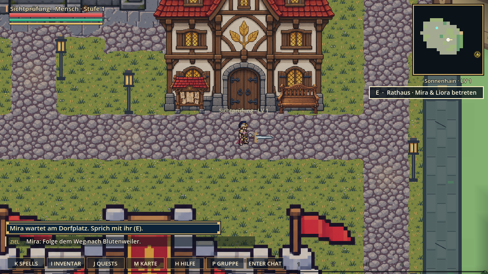
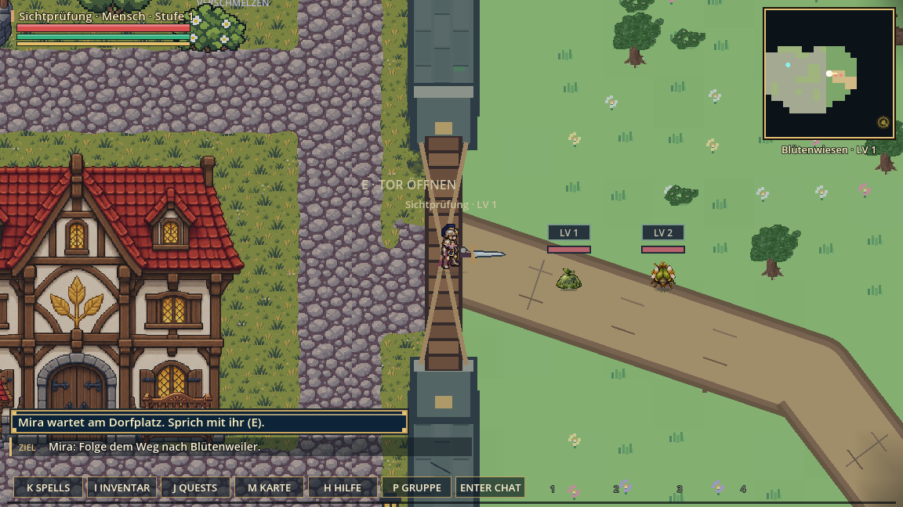
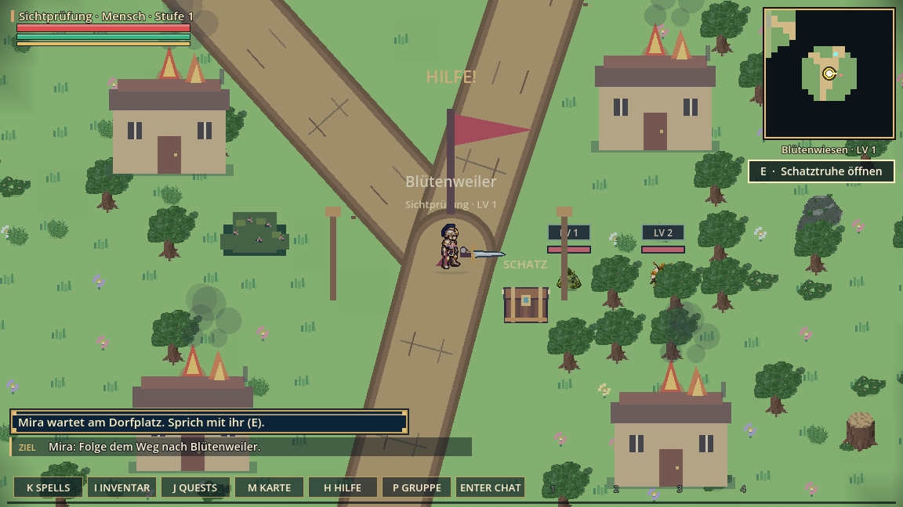
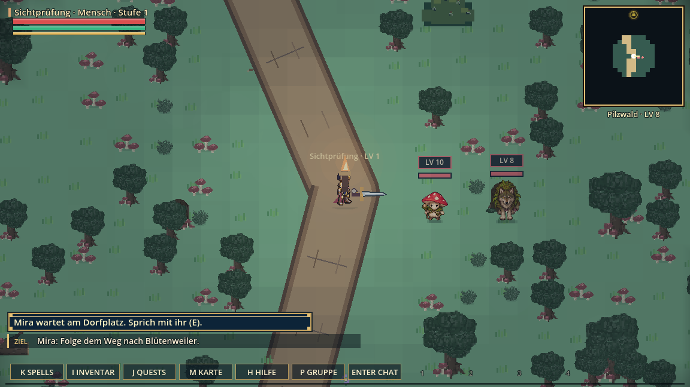
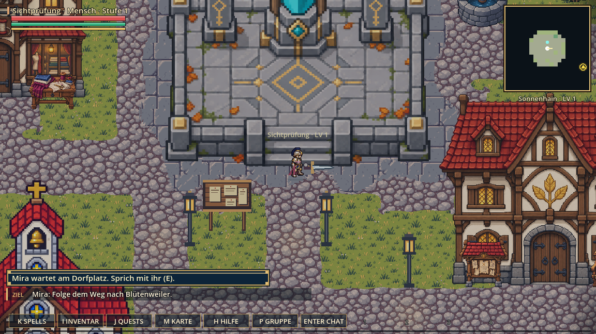

# Einstieg – Reparaturpaket und Prüfstand

Geprüft am 12. Oktober 2026 mit Godot 4.7.2 unter Windows.
Basis: `2683c10`, mit dem GitHub-Hauptstand per Fetch abgeglichen.

## Reparaturen

- Kartenaufdeckung sammelt kleine Bewegungsschritte bis zum nächsten Aufdeckpunkt. Der bestätigte dunkle Start bleibt erhalten.
- Laden respektiert echte Boss-/Gebietssperren statt empfohlener Gebietslevel. Legale Standorte und Wegsteine bleiben erhalten; gesperrte Ziele führen sicher ins Dorf.
- Der Dorf-Wegstein mit Index 0 bleibt auch beim zweiten Laden erhalten. Die alte Untergrenze 1 verwandelte ihn in einen Außenstein.
- Tafel und Bank vor der Ratshalle stehen 33 Pixel näher an der Fassade und lassen den Weg zum Osttor frei.
- Vorhandene Geschosskollisionen erhalten Holzklänge; Materialwiedergabe liegt in `components/projectile_impacts.gd`. Keine zusätzlichen Kollisionsflächen.

## Nachweise

- Vollständige lokale Auswahl gemäß `tools/run_all_tests.sh`, über den vorhandenen Windows-Runner `build/run_godot_checks.py`: **133 bestanden, 0 fehlgeschlagen**. Tests mit getrennten APPDATA-/TEMP-Verzeichnissen; keine echten Spielstände verwendet.
- Inhaltsprüfung `tools/check_content.py` und Browser-Brücke `tools/check_browser_bridge.cjs`: bestanden.
- `check_start_area_journey.gd`: echte Charakteranlage, Dorfweg, Osttor-Aktion, Blütenwiesen/Pilzwald, Rückweg, 1.781 Bewegungsschritte; Position, Questwerte, Nebel und Torzustand nach Dateispeicherung. Alle 18 Identitäten werden am Start geprüft, nicht auf der gesamten Route.
- Zusatzfälle über Dateispeicherung: Dorfstein, tatsächlich versiegeltes Gebiet, zweimaliges Laden, Fusionsrang 3 und anschließender frischer Charakter ohne fremde Fusion.
- Bestehende Charakterwechsel-, Fusions-, Speicherreparatur- und Netzwerkprüfungen bestehen. Ein Live-Relog mit einem betroffenen Konto wurde dadurch nicht nachgestellt.
- Webexport erstellt (Exit 0). Godot meldet in dieser Umgebung Zertifikatsspeicher-/Editor-Einstellungswarnungen; die lokalen Tests ersetzen keine Prüfung der TLS-Verbindung zum Live-Server.
- Aktuelle native Spielbilder unten visuell geprüft; 3D-Außenobjekte liefern im nativen Renderer sichtbare Pixel. Keine Bewertung der Spielbalance durch die gestellten Bilder.

Der erste Browserversuch mit `--script` im Webexport zeigte das normale Konto-Menü statt der isolierten Prüfszene. Er zählt daher **nicht** als bestandener Durchgang. Brave ist nicht als steuerbarer Browser verbunden. Brave-3D, tatsächliche Tiefensortierung in diesem Browser und ein echter Golem-Mehrspielerkampf bleiben Aufgabe 3 im Arbeitsplan. Der vorhandene 2D-Rückfall bleibt bestehen.

Die vollständige erste Questfolge und Kampf-Balance sind ebenfalls noch separat durchzuspielen. Die hier geprüfte Wegstrecke verwendet reguläre Kollision und Toraktion; für den Speicherfall wird ein Questfortschritt gezielt gesetzt.

## Spielbilder

Reproduktion der Bilder: `tools/capture_start_area.gd`. Netzwerk und Speichern sind in dieser Prüfszene deaktiviert.

## Veröffentlichung

Noch nicht live. Codeänderungen werden über einen Pull Request und CI geprüft. Live-Schaltung erst mit Angelos Bestätigung für dieses konkrete Paket.
