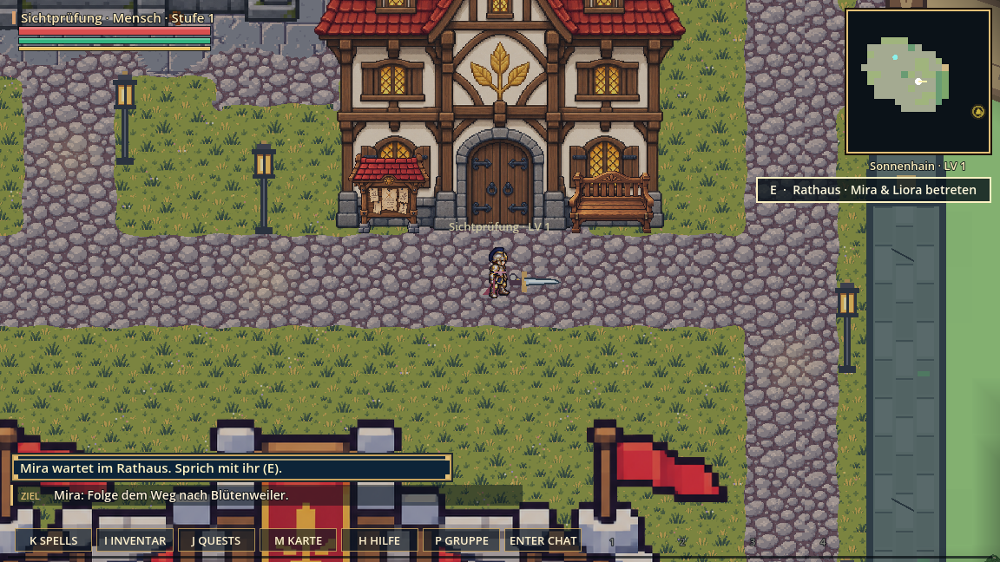

# Einstieg – Starttexte und bewegte Gegner

Stand: 12. Oktober 2026. Basis: veröffentlichter Commit `79bf216`.
Dieses Folgepaket ist noch nicht live.

## Änderung für Spieler

Die Startmeldung nennt jetzt Miras tatsächlichen Standort: „Mira wartet im Rathaus. Sprich mit ihr (E).“ Der kurze Wortlaut hält die Interaktionstaste im HUD sichtbar. Der Prolog nennt das Rathaus von Sonnenhain ebenfalls. Der bisherige Dorfplatz-Hinweis war veraltet.

## Verhalten mit bewegten Gegnern

Der neue Test `tests/gameplay/check_start_moving_combat.gd` verwendet die tatsächliche Einstiegsgeometrie, normale KI, Angriffsabstände und Abklingzeiten sowie beide Geschosspfade. Gegner müssen zuerst selbst mindestens 20 Pixel anlaufen; ihre Position wird während des Kampfes nicht festgesetzt. Je Klasse wird ein Schleim und anschließend ein Käfer bekämpft, ohne Heilung dazwischen und ohne angelegte Ausrüstung. Ein besiegter Schleim zählt zum angenommenen Mira-Auftrag.

| Klasse | Gegner | Angriffe | Kampfdauer | Gegnerbewegung | HP danach |
|---|---|---:|---:|---:|---:|
| Krieger | Schleim | 6 | 3,62 s | 142,31 px | 100 |
| Krieger | Käfer | 5 | 3,62 s | 163,63 px | 92 |
| Magier | Schleim | 7 | 4,30 s | 162,41 px | 100 |
| Magier | Käfer | 6 | 3,82 s | 159,65 px | 84 |
| Bogenschütze | Schleim | 7 | 3,85 s | 142,51 px | 100 |
| Bogenschütze | Käfer | 6 | 3,18 s | 145,41 px | 92 |

Kontrollierte Einzelkämpfe mit fester Zufallssaat; dies belegt keine allgemeine Kampf-Balance und keinen längeren Mehrgegnerkampf. Kampfwerte, Gegner-KI und Belohnungen werden mit diesem Paket nicht geändert.

## Prüfung

- Vollständige lokale Projektauswahl: **135 bestanden, 0 fehlgeschlagen**.
- Bestehender Hin-/Rückweg Sonnenhain → Blütenwiesen → Pilzwald und Speicher-/Questprüfungen bestehen weiterhin.
- Native Spielbilder aktualisiert und die gekürzte Startmeldung visuell kontrolliert. Die ursprünglichen Release-Bilder wurden erhalten.
- Eigene interaktive Prüfszene `tools/play_start_area.tscn`: frischer Charakter, normale Verarbeitung und Gegner-KI, keine Live-Verbindung und kein Schreiben echter Spielstände. Export mit `python tools/export_start_area_web.py /pfad/zu/godot --play`; Klassenwahl über `probe.html?class=0` (0 Krieger, 1 Magier, 2 Bogenschütze).
- Die interaktive Szene startete im Codex-Browser sichtbar. Nach der Bewegungseingabe scheiterte die Bildschirmkontrolle an einer Zeitüberschreitung; der erneute Start scheiterte am Anbinden der Browserseite. Daher **kein bestandener manueller Durchgang**. Die Browser-Unterbrechung ist kein Nachweis eines Spielfehlers.

Der manuelle zusammenhängende Einstieg mit bewegten Gegnergruppen, Ausweichen und Balancebewertung bleibt im Arbeitsplan offen. Ebenso Brave-3D und der echte Golem-Mehrspielerkampf. Das vorbereitete Prüfwerkzeug ermöglicht, diesen Durchgang fortzusetzen.
